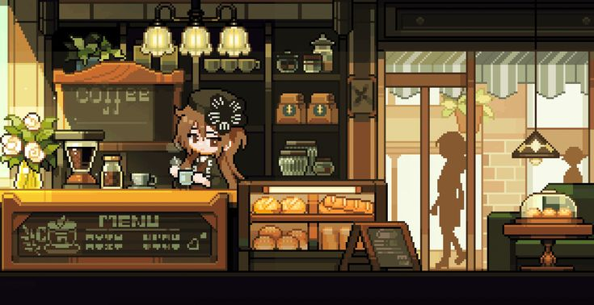
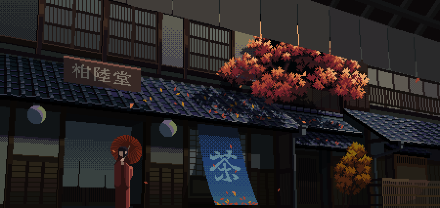
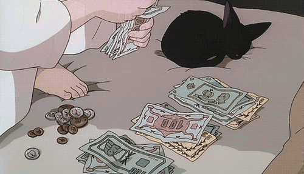
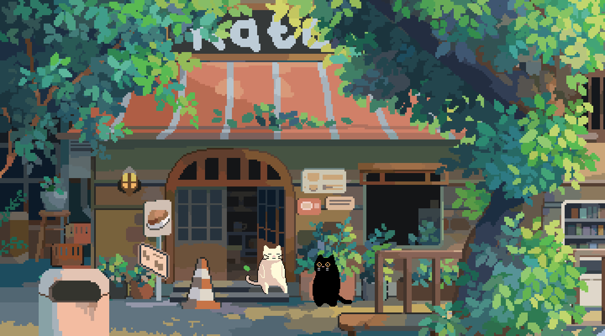

# 🏡 ข้างบ้าน
### COMMUNITY DEVELOPMENT PROPOSAL

*More Than Just a Discord Community.*

---

# 📑 สารบัญ | TABLE OF CONTENTS

> เลือกหัวข้อที่ต้องการเพื่อไปยังหมวดหมู่นั้นได้ทันที

| หมวดหมู่ | รายละเอียด |
|---|---|
| [🏡 01 — แนวคิดและเป้าหมาย](#-01--แนวคิดและเป้าหมาย) | เป้าหมายของชุมชน |
| [💬 02 — Q&A System](#-02--qa-system) | ระบบถามตอบ |
| [🎙️ 03 — Voice Rewards](#-03--voice-rewards) | ระบบรางวัลห้องเสียง |
| [🎒 04 — Inventory](#-04--inventory) | ระบบคลังไอเทม |
| [💰 05 — Wallet](#-05--wallet) | ระบบกระเป๋าเงิน |
| [🛒 06 — Community Shop](#-06--community-shop) | ระบบร้านค้าชุมชน |
| [⭐ 07 — Leveling](#-07--leveling) | ระบบเลเวล |
| [📜 08 — Quest](#-08--quest) | ระบบภารกิจ |
| [🎁 09 — Gacha](#-09--gacha) | ระบบสุ่มรางวัล |
| [🏪 10 — Player Market](#-10--player-market) | ตลาดซื้อขาย |
| [🏆 11 — Leaderboard](#-11--leaderboard) | ระบบจัดอันดับ |
| [🎉 12 — Event System](#-12--event-system) | ระบบกิจกรรม |
| [👤 13 — Member Profile](#-13--member-profile) | โปรไฟล์สมาชิก |
| [⚙️ 14 — Admin Management](#-14--admin-management) | ระบบจัดการทีมงาน |
| [🚀 15 — Development Plan](#-15--development-plan) | แผนการพัฒนา |
| [✨ 16 — Benefits](#-16--benefits) | ประโยชน์ที่ได้รับ |

---

# 🏡 01 — แนวคิดและเป้าหมาย

พัฒนา Discord **ข้างบ้าน** ให้เป็นมากกว่าพื้นที่พูดคุยทั่วไป โดยเพิ่มระบบกิจกรรม ระบบเศรษฐกิจ และระบบสะสมรางวัล

# 💬 02 — Q&A System

- ตั้งคำถามและตอบคำถาม
- เลือกคำตอบที่ดีที่สุด
- ให้คะแนนคำตอบ
- รับเงินและ EXP จากการช่วยเหลือ

# 🎙️ 03 — Voice Rewards

- รับเงินจากเวลาในห้องเสียง
- โบนัสเมื่ออยู่กับสมาชิกคนอื่น
- ป้องกัน AFK Farming
- ตรวจสอบประวัติการรับรางวัล

# 🎒 04 — Inventory

- ดูไอเทมที่ครอบครอง
- แบ่งระดับความหายาก
- ใช้ไอเทมได้
- รับไอเทมจากกิจกรรม

# 💰 05 — Wallet

- ตรวจสอบยอดเงิน
- รับและโอนเงิน
- ดูประวัติธุรกรรม

# 🛒 06 — Community Shop

- ซื้อไอเทมและยศ
- สินค้าจำกัดจำนวน
- สินค้าพิเศษตามเทศกาล
- ประวัติการซื้อ

# ⭐ 07 — Leveling

- รับ EXP จากการแชทและ Voice
- แจ้งเตือนเมื่อเลเวลอัป
- รางวัลและยศตามระดับ

# 📜 08 — Quest

- ภารกิจรายวันและรายสัปดาห์
- ติดตามความคืบหน้า
- รับเงิน EXP และไอเทม

# 🎁 09 — Gacha

- ระบบสุ่มไอเทม
- ระดับความหายาก
- แสดงอัตราการสุ่ม
- กล่องสุ่มกิจกรรม

# 🏪 10 — Player Market

- ลงขายและซื้อไอเทม
- กำหนดราคาเอง
- ประวัติการซื้อขาย
- ระบบป้องกันการโกง

# 🏆 11 — Leaderboard

- อันดับเงิน
- อันดับเลเวล
- อันดับผู้ช่วยเหลือ
- อันดับ Voice และ Quest

# 🎉 12 — Event System

- สร้างกิจกรรมโดยทีมงาน
- ลงทะเบียนและเช็กชื่อ
- แจกของรางวัล
- กิจกรรมพิเศษตามเทศกาล

# 👤 13 — Member Profile

- เลเวลและ EXP
- เงินและไอเทม
- ยศและความสำเร็จ
- สถิติการใช้งาน

# ⚙️ 14 — Admin Management

- จัดการเงินและไอเทม
- ปรับอัตรารางวัล
- ตรวจสอบประวัติ
- บันทึกการทำงานของทีมงาน

# 🚀 15 — Development Plan

| Phase | ระบบ |
|---|---|
| 01 | Q&A, Voice, Wallet, Inventory |
| 02 | Leveling, Profile, Quest |
| 03 | Shop, Gacha, Market |
| 04 | Leaderboard, Event, Achievement |
| 05 | Admin, Anti-Abuse, Logs, Backup |

# ✨ 16 — Benefits

- เพิ่มการมีส่วนร่วมของสมาชิก
- เพิ่มความคึกคักให้ห้องแชทและ Voice
- สร้างเศรษฐกิจภายในชุมชน
- เพิ่มกิจกรรมและเป้าหมาย
- ลดภาระการจัดการของทีมงาน

---

**🏡 ข้างบ้าน — More Than Just a Discord Community.**

*Community Development Proposal*

[⬆ กลับไปด้านบน](#-ข้างบ้าน)

