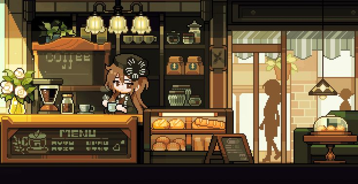
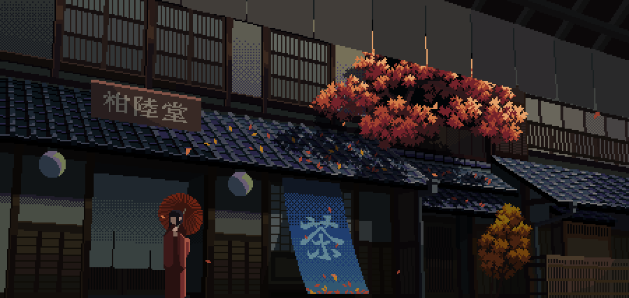
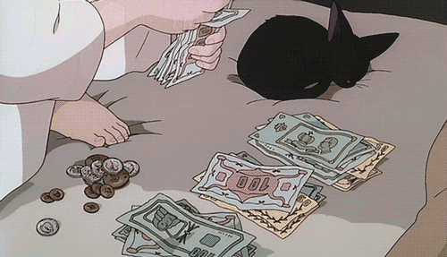
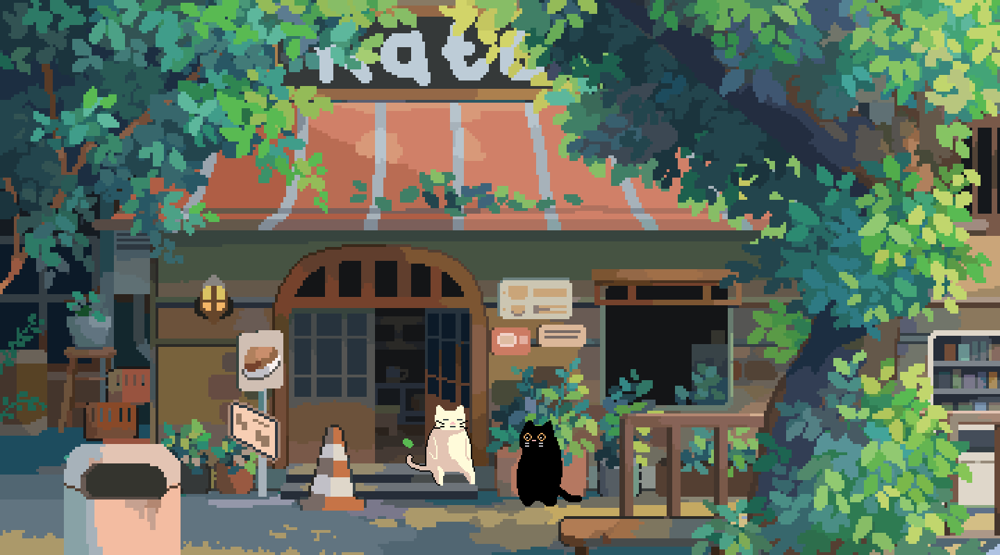

# 🏡 ข้างบ้าน
### COMMUNITY DEVELOPMENT

**ข้อเสนอการพัฒนาระบบ Discord Community**

*More Than Just a Discord Community.*

---

# 📑 TABLE OF CONTENTS

เลือกหมวดหมู่เพื่ออ่านรายละเอียดได้ทันที

| หมวดหมู่ | รายละเอียด |
|:--|:--|
| [🏡 01. Overview](#overview) | แนวคิดและเป้าหมาย |
| [💬 02. Q&A System](#qa) | ระบบถามตอบ |
| [🎙️ 03. Voice Rewards](#voice) | ระบบรางวัลห้องเสียง |
| [🎒 04. Inventory](#inventory) | ระบบคลังไอเทม |
| [💰 05. Wallet](#wallet) | ระบบกระเป๋าเงิน |
| [🛒 06. Community Shop](#shop) | ร้านค้าชุมชน |
| [⭐ 07. Leveling](#leveling) | ระบบเลเวล |
| [📜 08. Quest](#quest) | ระบบภารกิจ |
| [🎁 09. Gacha](#gacha) | ระบบสุ่มรางวัล |
| [🏪 10. Player Market](#market) | ตลาดซื้อขาย |
| [🏆 11. Leaderboard](#leaderboard) | ระบบจัดอันดับ |
| [🎉 12. Event System](#event) | ระบบกิจกรรม |
| [👤 13. Member Profile](#profile) | โปรไฟล์สมาชิก |
| [⚙️ 14. Admin Management](#admin) | ระบบจัดการทีมงาน |
| [🚀 15. Development Plan](#development) | แผนการพัฒนา |
| [✨ 16. Benefits](#benefits) | ประโยชน์ที่ได้รับ |

---

# 🏡 01 — OVERVIEW

## แนวคิดและเป้าหมาย

พัฒนา Discord **ข้างบ้าน** ให้เป็นมากกว่าพื้นที่พูดคุยทั่วไป โดยสร้างระบบที่ทำให้สมาชิกสามารถเข้าร่วมกิจกรรม สะสมไอเทม รับรางวัล ช่วยเหลือกัน และมีเป้าหมายในการกลับมาใช้งานเซิร์ฟเวอร์

**เป้าหมายหลัก**
- เพิ่มการมีส่วนร่วมของสมาชิก
- ทำให้ห้องแชทและห้องเสียงมีความคึกคัก
- สร้างระบบเศรษฐกิจภายในชุมชน
- เพิ่มกิจกรรมและเป้าหมายระยะยาว
- สร้างเอกลักษณ์ให้กับ Discord ข้างบ้าน

---

# 💬 02 — Q&A SYSTEM

**ระบบถามตอบและแบ่งปันความรู้**

- สมาชิกสามารถตั้งคำถามได้
- สมาชิกคนอื่นสามารถเข้ามาตอบได้
- เลือกคำตอบที่ดีที่สุดได้
- ให้คะแนนคำตอบและประเมินคุณภาพ
- รับเงินหรือ EXP จากการช่วยเหลือ
- มีโบนัสสำหรับคำตอบที่ได้รับเลือก

**ประโยชน์:** ส่งเสริมการช่วยเหลือกัน ลดภาระทีมงาน และเพิ่มการพูดคุยในชุมชน

---

# 🎙️ 03 — VOICE REWARDS

**ระบบรับรางวัลจากการใช้งานห้องเสียง**

- รับเงินตามระยะเวลาที่อยู่ใน Voice
- กำหนดอัตรารางวัลได้
- โบนัสเมื่ออยู่ร่วมกับสมาชิกคนอื่น
- เลือกห้องเสียงที่สามารถรับรางวัลได้
- ป้องกันการฟาร์ม AFK
- ตรวจสอบประวัติและสถิติได้

**ประโยชน์:** เพิ่มผู้ใช้งานห้องเสียงและสร้างบรรยากาศให้เซิร์ฟเวอร์

---

# 🎒 04 — INVENTORY SYSTEM

**ระบบคลังเก็บไอเทมส่วนตัว**

- ตรวจสอบไอเทมที่สมาชิกครอบครอง
- แสดงจำนวนและประเภทของไอเทม
- ใช้งานไอเทมได้
- แบ่งระดับความหายาก Common, Rare, Epic และ Legendary
- รับไอเทมจากกิจกรรมและภารกิจ
- มีประวัติการได้รับไอเทม

**ประโยชน์:** เพิ่มความสนุกในการสะสมและสร้างเป้าหมายให้สมาชิก

---

# 💰 05 — WALLET SYSTEM

**ระบบกระเป๋าเงินประจำตัวสมาชิก**

- ตรวจสอบยอดเงินส่วนตัว
- รับเงินจากกิจกรรมต่าง ๆ
- โอนเงินระหว่างสมาชิก
- ตรวจสอบประวัติธุรกรรม
- กำหนดอัตราการได้รับเงินได้
- เชื่อมต่อกับระบบร้านค้าและตลาด

**ประโยชน์:** สร้างระบบเศรษฐกิจภายในเซิร์ฟเวอร์

---

# 🛒 06 — COMMUNITY SHOP

**ระบบร้านค้าประจำชุมชน**

- ซื้อไอเทมด้วยเงินภายในเซิร์ฟเวอร์
- ซื้อยศและของตกแต่ง
- สินค้าพิเศษและ Limited
- สินค้าตามเทศกาลและกิจกรรม
- กำหนดราคาและจำนวนสินค้าได้
- ตรวจสอบประวัติการซื้อ

**ประโยชน์:** ทำให้เงินที่สมาชิกได้รับมีมูลค่าและมีเป้าหมายในการใช้งาน

---

# ⭐ 07 — LEVELING SYSTEM

**ระบบเลเวลและประสบการณ์**

- รับ EXP จากการพูดคุย
- รับ EXP จากการใช้งานห้องเสียง
- รับ EXP จากการช่วยเหลือสมาชิก
- แจ้งเตือนเมื่อเลเวลอัป
- มีรางวัลตามระดับเลเวล
- มียศพิเศษตามความสำเร็จ

**ประโยชน์:** สร้างเป้าหมายระยะยาวและกระตุ้นการใช้งาน

---

# 📜 08 — QUEST SYSTEM

**ระบบภารกิจประจำชุมชน**

- ภารกิจรายวัน
- ภารกิจรายสัปดาห์
- ภารกิจพิเศษจากทีมงาน
- ภารกิจพูดคุยและเข้าห้องเสียง
- ภารกิจช่วยเหลือและตอบคำถาม
- ระบบติดตามความคืบหน้า
- รับเงิน EXP และไอเทมเป็นรางวัล

**ประโยชน์:** เพิ่มกิจกรรมให้สมาชิกมีสิ่งที่ทำอย่างต่อเนื่อง

---

# 🎁 09 — GACHA SYSTEM

**ระบบสุ่มไอเทมและกล่องรางวัล**

- ใช้เงินหรือไอเทมเพื่อสุ่ม
- มีระดับความหายากหลายระดับ
- มีไอเทมพิเศษและไอเทมหายาก
- แสดงอัตราการสุ่มอย่างชัดเจน
- รองรับกล่องสุ่มตามเทศกาล
- มีประวัติการสุ่ม

**ประโยชน์:** เพิ่มความตื่นเต้นและความสนุกในการสะสม

---

# 🏪 10 — PLAYER MARKET

**ระบบตลาดซื้อขายระหว่างสมาชิก**

- สมาชิกสามารถลงขายไอเทมได้
- กำหนดราคาขายเอง
- สมาชิกอื่นสามารถซื้อได้
- ตรวจสอบรายการซื้อขาย
- มีประวัติการทำธุรกรรม
- มีระบบป้องกันการโกงและตรวจสอบรายการผิดปกติ

**ประโยชน์:** สร้างปฏิสัมพันธ์และทำให้เศรษฐกิจหมุนเวียนภายในชุมชน

---

# 🏆 11 — LEADERBOARD

**ระบบจัดอันดับสมาชิก**

- อันดับยอดเงิน
- อันดับเลเวล
- อันดับผู้ช่วยเหลือสมาชิก
- อันดับผู้ตอบคำถาม
- อันดับเวลาใช้งานห้องเสียง
- อันดับผู้ทำภารกิจ
- มีรางวัลสำหรับสมาชิกอันดับต้น ๆ

**ประโยชน์:** สร้างการแข่งขันที่เป็นมิตรและกระตุ้นการมีส่วนร่วม

---

# 🎉 12 — EVENT SYSTEM

**ระบบจัดกิจกรรมภายในเซิร์ฟเวอร์**

- ทีมงานสามารถสร้างกิจกรรมได้
- ระบบลงทะเบียนและเช็กชื่อ
- ระบบแจกของรางวัล
- กิจกรรมประจำสัปดาห์
- กิจกรรมพิเศษตามเทศกาล
- กำหนดกติกาและรางวัลได้

**ประโยชน์:** สร้างความสัมพันธ์และเพิ่มความสนุกให้กับสมาชิก

---

# 👤 13 — MEMBER PROFILE

**ระบบโปรไฟล์สมาชิก**

- แสดงเลเวลและ EXP
- แสดงยอดเงินและไอเทม
- แสดงยศและความสำเร็จ
- แสดงสถิติการใช้งาน
- ระบบ Achievement
- สามารถตรวจสอบโปรไฟล์สมาชิกคนอื่นได้

**ประโยชน์:** ทำให้สมาชิกมีตัวตนและมีผลงานภายในชุมชน

---

# ⚙️ 14 — ADMIN MANAGEMENT

**ระบบจัดการสำหรับทีมงาน**

- เพิ่มและลบเงินสมาชิก
- เพิ่มและลบไอเทม
- ปรับอัตราการได้รับรางวัล
- ตรวจสอบประวัติธุรกรรม
- จัดการการตั้งค่าระบบ
- ตรวจสอบประวัติการทำงานของทีมงาน
- ระบบบันทึกการเปลี่ยนแปลง
- ระบบป้องกันการใช้งานคำสั่งโดยไม่ได้รับอนุญาต

**ประโยชน์:** ช่วยให้ทีมงานจัดการระบบได้ง่ายและตรวจสอบย้อนหลังได้

---

# 🚀 15 — DEVELOPMENT PLAN

**แผนการพัฒนาเป็นระยะ**

| Phase | ระบบที่พัฒนา |
|:--|:--|
| Phase 01 | Q&A, Voice Rewards, Wallet, Inventory |
| Phase 02 | Leveling, Member Profile, Quest |
| Phase 03 | Shop, Gacha, Player Market |
| Phase 04 | Leaderboard, Event, Achievement |
| Phase 05 | Admin Management, Anti-Abuse, Logs, Backup |

การพัฒนาแบ่งเป็นระยะเพื่อให้สามารถทดสอบและปรับปรุงแต่ละระบบก่อนเปิดใช้งานจริง

---

# ✨ 16 — COMMUNITY BENEFITS

**ประโยชน์ที่คาดว่าจะได้รับ**

- สมาชิกมีส่วนร่วมกับเซิร์ฟเวอร์มากขึ้น
- ห้องแชทและห้องเสียงมีความคึกคัก
- สมาชิกสามารถช่วยเหลือและแบ่งปันความรู้
- เกิดระบบเศรษฐกิจภายในชุมชน
- มีเป้าหมายและกิจกรรมให้ทำอย่างต่อเนื่อง
- เพิ่มความสัมพันธ์ระหว่างสมาชิก
- ทีมงานสามารถจัดการระบบได้สะดวกขึ้น
- สร้างเอกลักษณ์ให้ Discord ข้างบ้าน

---

# 💡 ADDITIONAL NOTES

ไม่จำเป็นต้องพัฒนาทุกระบบพร้อมกัน ควรเริ่มจากระบบที่ช่วยเพิ่มการมีส่วนร่วมก่อน แล้วค่อยขยายไปยังระบบเศรษฐกิจและกิจกรรม

ควรมีระบบป้องกันการฟาร์มเงินและ EXP รวมถึงระบบตรวจสอบธุรกรรม เพื่อให้ระบบมีความสมดุลและยุติธรรมกับสมาชิกทุกคน

---

# 🏡 ข้างบ้าน

**MORE THAN JUST A DISCORD COMMUNITY.**

*Community Development Proposal*

[⬆ กลับไปด้านบน](#-ข้างบ้าน)

